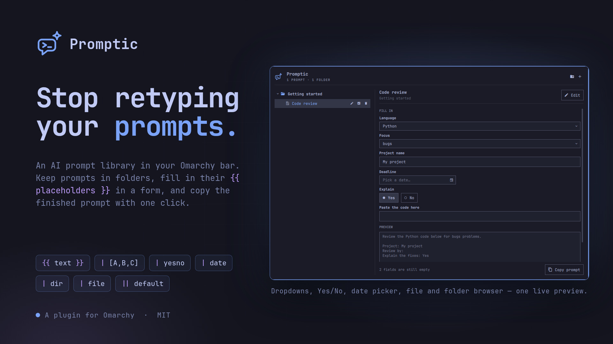
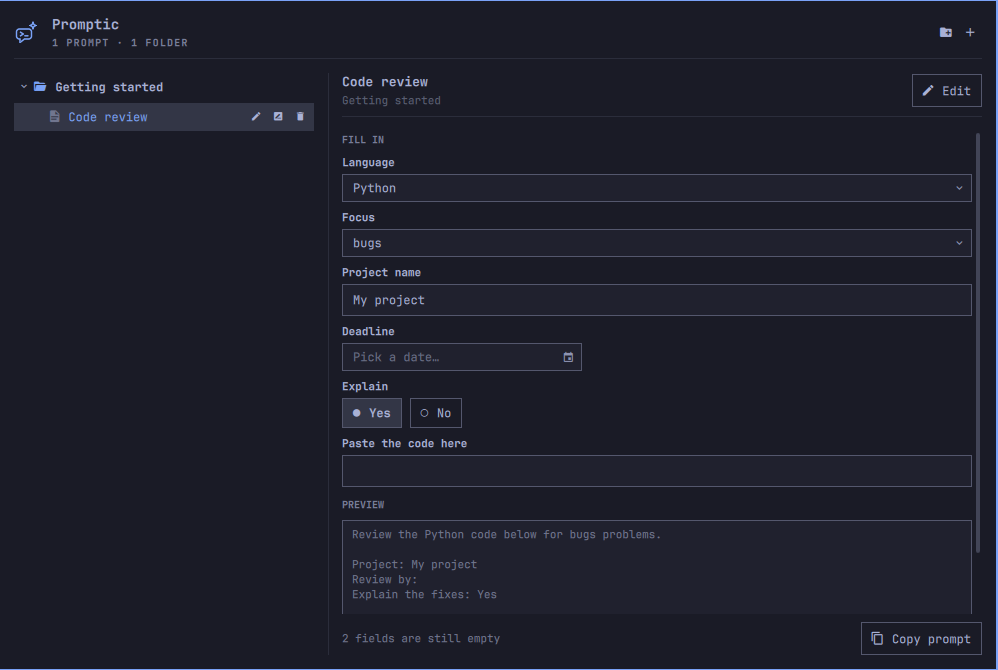

<p align="center">
  
</p>

# Promptic

**An AI prompt library for the Omarchy bar. Keep your prompts in folders, fill in their `{{ placeholders }}` in a form, and copy the finished prompt to the clipboard with one click.**

You reuse the same prompts all the time: a code review, a commit message, a meeting summary, a bug report. Promptic keeps them in one place. A prompt can contain placeholders, so the parts that change (the language, the deadline, the file) become form fields instead of text you edit by hand.

<p align="center">
  
</p>

## Contents

- [Features](#features)
- [Placeholder syntax](#placeholder-syntax)
- [Examples](#examples)
- [Using the panel](#using-the-panel)
- [Keyboard](#keyboard)
- [Requirements](#requirements) · [Install](#install) · [Uninstall](#uninstall)
- [Privacy](#privacy) · [Where things are stored](#where-things-are-stored) · [How it works](#how-it-works)

## Features

**Organise**
- **Folders and prompts in a tree.** Folders nest as deep as you like and remember whether they are open.
- **New folder = an editable row.** Click the folder button, type a name, press `Enter`. `Esc` cancels and removes it again.
- **Rename in place** for folders and prompts (`r` / `F2` / the pencil-box button).
- **Delete** folders and prompts. A folder takes everything inside it along, and Promptic tells you how many items that is before you confirm.
- **Move** a prompt to another folder from the edit popup.
- Folders are listed first and everything is sorted alphabetically.

**Write**
- **Add or edit a prompt in a popup** with a name, a folder and a large text box for the prompt. A counter shows how many placeholders it found.
- The prompt is plain text. Paste anything, including multi-line prompts.

**Fill in and copy**
- **A form on the right** with one field per placeholder, plus a **live preview** of the finished prompt.
- **Eight field types**: text, text with default, dropdown, yes/no radio, date picker, folder and file (see below).
- **One-click copy** ("Copy prompt", or `Ctrl+Enter`) to the Wayland clipboard. The button turns into "Copied" as confirmation.
- A status line tells you how many fields are still empty.
- The same label used twice in a prompt is one field and fills both places.
- Values you typed are kept while you switch between prompts.

**Fits Omarchy**
- A bar widget with its own logo, themed with your Omarchy colours and fonts.
- Works with the keyboard alone, or with the mouse alone.
- No default shortcut, no network, no AI calls. See [Privacy](#privacy).

## Placeholder syntax

A placeholder is a word or sentence wrapped in double braces: `{{ like this }}`. Whitespace around the label does not matter.

| Write this | You get |
|---|---|
| `{{ Topic }}` | A text box (multi-line) |
| `{{ Colour \|\| Red }}` | A text box that starts with `Red` |
| `{{ Letter \| [A,B,C] }}` | A dropdown with A, B and C |
| `{{ Letter \| [A,B,C] \|\| B }}` | The same dropdown, starting on B |
| `{{ Awake? \| yesno }}` | A **Yes** / **No** radio |
| `{{ Birthday \| date }}` | A date picker |
| `{{ Project \| dir }}` | A folder path with a **Browse…** button |
| `{{ Config \| file }}` | A file path with a **Browse…** button |

The part after a single `|` is the **format**. The part after a double `||` is the **default**, and it works with every format.

**Defaults per type**

| Type | Default you can write | Without a default |
|---|---|---|
| text | any text | empty |
| dropdown | one of the options (case-insensitive) | the first option |
| yesno | `yes` / `no` (also `y`, `n`, `true`, `false`, `ja`, `nee`) | nothing selected |
| date | `today`, or a date as `2026-10-06` | empty |
| dir / file | a path | empty |

**Good to know**
- Dates are copied as `yyyy-mm-dd`. The picker has a **Today** button and a clear button.
- The **dir** popup is a small folder browser: open folders, then press **Select this folder**. The **file** popup lists files too; click one to pick it. Both have a path bar, a Home button, a toggle for hidden files and work with `j` `k` `h` `l`. They are built into Promptic, so no desktop portal or extra tool is needed. You can also just type or paste a path.
- Options are separated by commas. An empty `[]` is treated as a plain text field.
- A label with nothing in it, like `{{ }}`, is left exactly as written.

## Examples

Paste any of these into **New prompt** and you have a working template.

### A code review

```text
Review the {{ Language | [TypeScript,Python,Go,Rust,Other] || Python }} code below for {{ Focus | [bugs,security,performance,readability] }} problems.

Project: {{ Project name || My project }}
Review by: {{ Deadline | date }}
Explain the fixes: {{ Explain | yesno || yes }}

Code:
{{ Paste the code here }}
```

You get a language dropdown that starts on Python, a focus dropdown, a text box with a default, a date picker, a Yes/No radio that starts on Yes, and a big box for the code. This is the example that comes with Promptic.

### A commit message

```text
Write a {{ Style | [Conventional Commits,plain sentence,emoji + sentence] || Conventional Commits }} commit message for this diff.
Keep the subject under {{ Max length || 72 }} characters.
Is this a breaking change? {{ Breaking | yesno || no }}

{{ Paste the diff }}
```

### A meeting summary

```text
Summarise the notes below for {{ Audience | [the team,management,a customer] }}.
Meeting date: {{ Date | date || today }}
Tone: {{ Tone || short and friendly }}
Include action items and owners: {{ Action items | yesno || yes }}

{{ Paste the notes }}
```

`today` fills the date in for you every time you open the prompt.

### Work on a project folder

```text
You are working in the repository at {{ Repository | dir || ~/Work }}.
Read {{ Entry point | file }} first, then {{ Task || fix the failing tests }}.
Do not touch anything outside {{ Repository }}.
```

`{{ Repository }}` is used twice and appears once in the form. The second one has no format or default of its own, because the first occurrence decides the type.

### A translation

```text
Translate the text below from {{ From | [English,Dutch,German,French,Spanish] || Dutch }} to {{ To | [English,Dutch,German,French,Spanish] || English }}.
Register: {{ Register | [formal,informal] || informal }}

{{ Text }}
```

## Using the panel

1. Click the Promptic icon in the bar (a speech bubble with a prompt and a spark).
2. On the left, build your library:
   - The folder button adds a folder inside the selected folder (or next to the selected prompt).
   - The `+` button adds a prompt in the selected folder.
   - Hover a row for its buttons: add a prompt (folders), edit, rename, delete.
   - Click empty space in the tree to deselect, so new things land at the top level.
3. Select a prompt. The form appears on the right.
4. Fill in the fields and check the preview.
5. Press **Copy prompt** and paste it wherever you need it.

Double-click a prompt to edit it.

## Keyboard

| Where | Key | Action |
|---|---|---|
| Tree | `j` `k` / `↓` `↑` | Move |
| | `l` `h` / `→` `←` | Expand / collapse, step into / out of a folder |
| | `Enter` | Open or close a folder |
| | `n` | New prompt (in the selected folder) |
| | `Shift+N` | New folder |
| | `e` | Edit the selected prompt |
| | `r` / `F2` | Rename in place |
| | `x` / `Delete` | Delete (asks first) |
| | `Ctrl+Enter` | Copy the finished prompt |
| Form | `Tab` / `Shift+Tab` | Next / previous field |
| | `Ctrl+Enter` | Copy the finished prompt |
| | `Esc` | Back to the tree |
| Prompt popup | `Ctrl+Enter` | Save |
| | `Esc` | Cancel |
| Folder / file popup | `j` `k` `h` `l`, `Enter` | Move, go up, open |
| Anywhere | `Esc` | Close |

Promptic does not bind a global shortcut. To open it with one, add a bind of your own to `~/.config/hypr/bindings.lua` that runs:

```bash
omarchy-shell io.github.hpolthof.promptic toggle
```

The same target also understands `open` and `close`.

## Requirements

- Omarchy with the Quickshell-based `omarchy-shell`
- `wl-copy` (from `wl-clipboard`, included with Omarchy)

## Install

```bash
omarchy plugin add https://github.com/hpolthof/omarchy-promptic.git --enable
```

Promptic appears on the right of the bar. To put it somewhere else:

```bash
omarchy bar move io.github.hpolthof.promptic --section left   # or center
```

## Uninstall

```bash
omarchy plugin remove io.github.hpolthof.promptic
```

This removes the plugin and its bar button. Promptic installs nothing outside its own plugin folder and binds no shortcuts, so there is nothing else to undo. Your library stays where it is in case you come back. To remove it too:

```bash
rm -rf ~/.local/state/omarchy/promptic
```

## Privacy

Promptic never uses the network and never calls an AI. The only program it runs is `wl-copy`, and the prompt reaches it on standard input, so it does not show up in process listings. All text, yours included, is rendered as plain text.

## Where things are stored

| What | Where |
|---|---|
| Folders and prompts | `~/.local/state/omarchy/promptic/library.json` |

The file is written atomically and is plain JSON, so it is easy to back up or sync. If you edit it by hand, Promptic picks the change up. A broken or missing file is never overwritten until you change something yourself; on a first run you see the example library and nothing is written.

## How it works

```
BarWidget.qml     host: store, clipboard process, IPC, bar button
Store.qml         the library (FileView, atomic writes)
Model.js          template parser and tree helpers (tested with node)
Panel.qml         the panel
LibraryTree.qml   folders and prompts, in-place rename
UsePane.qml       the form, preview and copy button
PromptDialog.qml  add / edit popup
DateField.qml     date picker
FilePicker.qml    folder / file chooser
PrompticIcon.qml  the logo, drawn as strokes
```

Run the tests for the template parser and the tree with:

```bash
node tests/model_check.mjs
```

## License

MIT © Paul Olthof
